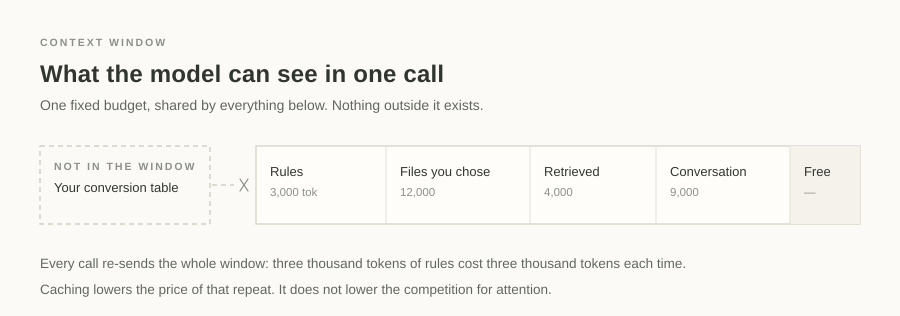

“Vibe coding” was coined in February 2025 / for something simple: / you describe what you want, / the model writes the code, / and you judge the result / by whether it runs. // Less than two years later / the phrase covers everything / from a weekend prototype / to a production release, / and most of the words around it / arrived faster than the practice did. //

The vocabulary is not actually large. // Seven terms explain almost all of it: / token, / context window, / prompt, / agent, / MCP, / retrieval, / hallucination. // What follows is each one, / what it means, / and what it changes / when you sit down to build something. //

<h2>1. The model is the smallest part</h2>

A large language model / predicts the next token. // It reads what is in front of it / and continues. // That is the whole mechanism. // It does not know your system, / your data, / or your rules; / it has read a great many systems / that look like yours. //

Two habits follow from that, / and both cost people days. // The first: / a model rarely says “I do not have enough information”. // It continues anyway, / in the most plausible direction, / because continuing is what it does. // The second: / it agrees with the premise you bring. // If you describe your schema slightly wrong, / the code will faithfully implement the wrong schema. //

So the useful question / is never whether the model is smart enough. // It is whether it has enough to work with, / and whether you would notice if it were wrong. //

<h2>2. Token: the only unit that shows up on the invoice</h2>

A token is not a word. // It is a fragment, / usually three or four characters in English, / and the split does not follow meaning. // <code>RetailToSaleOrder</code> does not arrive as one thing. // Depending on the tokeniser / it might arrive roughly as <code>Ret|ail|To|Sale|Order</code> — / recognisable to us, / slightly foreign to the model. //

This matters twice. // Once on the bill: / input and output are priced per token, / and cached input is cheaper than fresh input. // And once on the work: / a name the tokeniser chops in an awkward place / is harder to reproduce exactly / than a short one. // That is one reason short, plain identifiers survive better / than long compound ones / in generated code. //

Context windows are large now — / hundreds of thousands of tokens, / a million on some models. // Large is not the same as free. // A three-thousand-token rule file / is paid for on every single call, / and it competes for attention / with the question you actually asked. //

<h2>3. Context is the skill</h2>

The definition worth keeping / comes from Andrej Karpathy: / context engineering is filling the window / with exactly the right information / for the next step. // Not more information. / The right information. //

<figure class="article-figure">
  
  <figcaption>The window is the whole world for one call. A table you never pasted is not “forgotten” — it does not exist yet.</figcaption>
</figure>

In practice it comes down to four moves. // Write: / put the stable rules where the model reads them every time, / such as an <code>AGENTS.md</code> file in the repository. // Select: / pull in only the files that matter for this task. // Compress: / summarise at the end of a long session, / before the early decisions drift out of view. // Isolate: / hand a messy sub-problem to a separate agent, / so it cannot pollute the main thread. //

A rule that has saved me more time than any prompt: / the rules file should contain only what the model cannot infer from the code. // Build and test commands. / Boundaries between modules. / The files that must not be touched. / What “done” means. // Not coding style — / that is visible in the files themselves, / and repeating it just spends attention. //

<h2>4. Agent: model, tools, loop</h2>

An agent is a model that can call tools / and keep going until it decides to stop. // Tool calling is the mechanism; / the loop is what makes it feel different / from a chat window. // It reads a file, / runs a test, / reads the failure, / edits again. //

<figure class="article-figure">
  
  <figcaption>The loop is the difference between a chat and an agent. The exit is not a decision you make — it is the model stopping, or a limit you set.</figcaption>
</figure>

MCP — the Model Context Protocol — / is the standard that lets those tools be plugged in once / and used by many clients. // In 2026 the protocol moved to a stateless core / and gained a skills extension / that loads instructions in stages: / metadata first, / the full procedure only when a task needs it. // The practical effect is smaller than the announcement. // Fewer custom integrations, / and instructions that travel with the tool / instead of being pasted into a prompt. //

Two rules I keep, / because every tool is also a way to break something. // Give the agent the fewest tools the task needs. // And make anything with a side effect — / a write, a deploy, a send — / require a confirmation. // A tool that can drop a table does not improve the answer; / it only raises the cost of being wrong. //

<h2>5. Retrieval: when to search instead of paste</h2>

Retrieval-augmented generation / means fetching documents at question time / and putting them in the window. // Underneath it are embeddings: / text turned into vectors, / so “find passages about this idea” becomes a distance calculation. //

It works well when the question is about meaning: / “what does our policy say about returns”; / “find the section on cutover”. // It works badly for exact things: / a field name, / an error code, / a table called <code>SHETD20260917001</code>. // For those, plain search is still better — / <code>grep</code> does not approximate, / and it cannot be talked into a confident near-match. //

My own split: / retrieve for prose, / search for identifiers, / and paste the schema by hand when it matters. // The last one is unglamorous / and it is usually the fastest. //

<h2>6. Why it can be confidently wrong</h2>

A hallucination is fluent output with no basis in the input. // It is not a bug that appears now and then; / it is the same mechanism working without enough to work from. // The model was trained to produce plausible continuations, / and plausible is not the same as true. //

Temperature is often mistaken for a truth dial. // It controls randomness in sampling. // Lower it and the output becomes more repeatable; / it does not become more correct. // The remedy for a wrong answer / is a better source / or a check — / not a colder setting. //

<h2>7. Where vibe coding stops</h2>

Karpathy has since revised his own phrase / toward agentic engineering, / and the reason is practical. // Vibe coding judges output by whether it looks right. // A prototype can live with that. // Production cannot. //

<table class="seg-table">
<thead><tr><th></th><th>Vibe coding</th><th>Agentic engineering</th></tr></thead>
<tbody>
<tr><td>You judge by</td><td>Does it look right?</td><td>Does it pass the checks?</td></tr>
<tr><td>Context</td><td>Whatever happens to be in the chat</td><td>Rules file, chosen files, defined tools</td></tr>
<tr><td>When it breaks</td><td>You notice later</td><td>A test or an eval fails</td></tr>
<tr><td>Good for</td><td>A prototype, a one-off script</td><td>Anything someone depends on</td></tr>
</tbody>
</table>

The dividing line is verification. // Tests cover the deterministic part: / given this input, / this output. // Evaluations cover the rest: / a set of cases, / a score, / a run you can repeat. // Without both, / whatever the prompt looks like, / you are still vibing. //

The numbers in 2026 are large enough to be worth stating plainly. // A Google whitepaper on the new software lifecycle reports that / around 85% of professional developers now use AI coding agents daily, / and that 41% of new code is generated. // If that is the baseline, / the scarce skill is not writing prompts. // It is knowing how you would catch a wrong answer. //

<h2>8. One example from my own work</h2>

I was fixing a script / that turns retail orders into sales orders / in an ERP system. // The model produced a mapping / that looked completely reasonable: / field to field, / one clean table. // It was wrong on units. // A carton is not a piece, / and the conversion sat in a different table / that I had not given it. //

The fix was not a better prompt. // I gave it the two schemas, / two worked examples — / one carton case, one piece case — / and a check script that compares totals before and after. // Same model, / same week, / correct output. // What changed was the context, / and the fact that something could fail loudly. //

That is the whole method, / and it is the same three moves every time: / put the right things in the window, / ask for something checkable, / and keep a way to prove it wrong. //

<h2>9. What to remember</h2>

A model continues text. // It bills by token. // It can only use what is in the window. // An agent adds tools and a loop, / and tools need limits. // Retrieval helps with documents / and disappoints with exact lookups. // Confidence is not evidence. //

Everything else is fashion, / including the name. // The words will change again this year. // The habit will not. //

