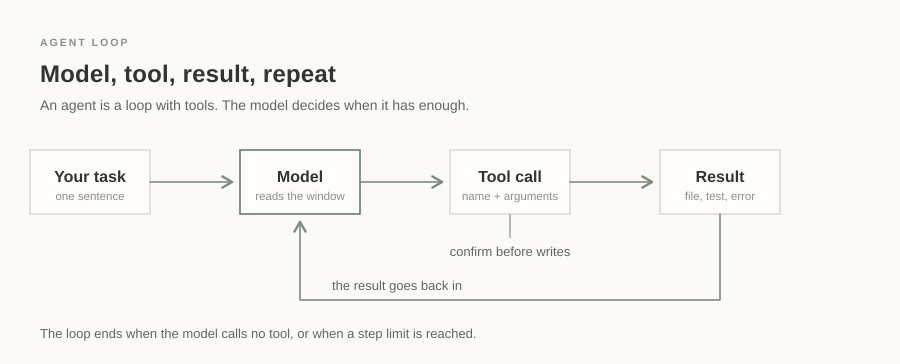

This is a translation, not an essay. // The source is Yu Pi's <a href="https://github.com/liyupi/ai-guide">Vibe Coding concept guide</a>, / a Chinese glossary of eighty-two terms / that has become the standard reference for people learning AI coding there. //

I have kept the original order, / the original analogies, / and the original figures — / including the model names and prices, / which are as the source states them in 2026. // Where a table or a diagram makes the structure easier to hold, / I have added one. // The L1 to L3 grades are also mine; / the source does not grade its terms. //

Read it as a dictionary, / or read it in order as a course. // The eight chapters build: / the model, / the prompt, / the modes, / the context, / the output, / the tools, / the project words, / and the stack underneath. //

<a href="#model">1 · The model</a> · <a href="#prompt">2 · The prompt</a> · <a href="#modes">3 · The modes</a> · <a href="#context">4 · The context</a> · <a href="#output">5 · The output</a> · <a href="#tools">6 · The tools</a> · <a href="#project">7 · The project words</a> · <a href="#stack">8 · Front end, back end</a>

L1daily useL2once you start buildingL3specialist, still moving. The grades are a reading aid added here; the source does not grade its terms.

<h2 id="model">1. The model</h2>

<h3 class="term">Artificial intelligenceL1</h3>

The technology that lets computers imitate human intelligence — in plain words, a machine that thinks, learns and solves problems the way a person does.

In vibe coding, AI is your programming assistant: you say what you want, and it drafts the approach, writes the code and fixes the bugs. The source's image is a programmer friend who is online twenty-four hours a day.

<h3 class="term">Large language modelL1</h3>

An AI system that understands and generates human language. ChatGPT, Claude, Gemini and DeepSeek are all large language models.

Why “large”? Because the number of parameters is enormous — tens of billions, sometimes trillions. More parameters usually mean a smarter model, and a more expensive one to run. The source's analogy: a top student who has read an ocean of books and code, which is why it can write, explain and repair code for you.

Text models are not the only kind: there are vision models (Stable Diffusion), audio models (Whisper), and multimodal models that handle text, images and sound together (GPT-4o, Gemini). For AI coding, you mostly deal with the text ones.

<h3 class="term">TokenL1</h3>

The basic unit of text a model processes — a “word piece”, the smallest thing the text is broken into.

It is the concept you cannot skip, because AI services bill by token: what you send and what comes back both consume them, and more tokens means more money. In English a token is roughly a word or part of one. Different models use different tokenisers, so the same passage can cost different amounts in different models.

<table class="seg-table">
<thead><tr><th>What you send</th><th>Roughly</th></tr></thead>
<tbody>
<tr><td><code>Hello World</code></td><td>about 2 tokens</td></tr>
<tr><td>the same greeting in Chinese</td><td>about 4 to 6 tokens</td></tr>
</tbody>
</table>

Chinese-first models such as Qwen and DeepSeek optimise for the language, so one token covers about 1.5 to 1.8 Chinese characters — noticeably more efficient than the early English-first models. Most coding tools now show a running token count, so you can watch the cost while you work.

<h3 class="term">Input and output tokensL1</h3>

Billing separates what goes in from what comes out. Input tokens are your prompt, code and files; output tokens are the answer, the generated code and the tool calls.

Output is generally the more expensive half, because generating costs more compute than reading. In the source's example, Claude Sonnet 4 charges $3 per million input tokens and $15 per million output tokens — five times more for output.

The cheapest saving is still the simplest: write prompts that are clear enough to be understood in one pass, so you do not pay for the same explanation three times.

<h3 class="term">Token cachingL2</h3>

A mechanism that saves real money. When you keep talking to the same model, much of the prompt repeats — the system instruction, the files you attached — and recomputing it every time is waste. Caching stores the intermediate result and reuses it when the same prefix appears again.

Cached tokens come in two kinds: writing the cache costs slightly more than normal input the first time, and reading it later can cost as little as one tenth of normal input.

The practical advice: keep the top of your context stable. If your rules file and reference files do not change between turns, you keep getting the discount — which is why one long conversation can be cheaper than three short ones.

<h3 class="term">Model parametersL2</h3>

The “knowledge points” a model learned during training, stored as numbers. If it read countless statements that the sky is blue, the association between sky and blue lives in the parameters. More parameters, more associations retained.

Parameter count drives both capability and running cost: a larger model is usually smarter and usually needs more GPU compute per request.

<table class="seg-table">
<thead><tr><th>Model (as the source lists it)</th><th>Parameters</th><th>Note</th></tr></thead>
<tbody>
<tr><td>DeepSeek V4.1 Flash</td><td>552B</td><td>MoE, natively multimodal</td></tr>
<tr><td>GLM-5.4</td><td>~750B</td><td>Loop Transformer architecture</td></tr>
<tr><td>Qwen4-Max</td><td>2.4T</td><td>MoE, 71–95B active per call</td></tr>
<tr><td>Kimi K3.1 Pro</td><td>2.8T</td><td>MoE, 104B active</td></tr>
</tbody>
</table>

The trend worth noticing: size and capability are no longer a straight line. The source points out that a 552B model can beat a 1.6T model of the same family, and that architectural changes such as looping a middle layer twice raise the ceiling without adding parameters. Vendors also ship several sizes of the same family, so you can trade cost against capability.

<h3 class="term">Training and inferenceL2</h3>

Training is how a model learns from large amounts of data. It takes enormous compute and time, and it is done by the AI companies — you almost never train a model yourself; you use a finished one.

Inference is using the trained model to answer and generate. Every chat with ChatGPT and every request to Cursor is inference.

The source's analogy: training is a student going to school and studying; inference is that student sitting an exam.

<h3 class="term">Fine-tuningL3</h3>

Continuing to train an existing model on domain-specific data so it performs better in one area — medical records to make a medical specialist, or your company's codebase to make it familiar with your style.

For ordinary users the cost is high and it is usually unnecessary; a ready-made model is enough. Platforms such as Alibaba Cloud Bailian and Volcano Engine offer fine-tuning as a service, which lowers the barrier.

<h3 class="term">DistillationL3</h3>

Compressing a large model's knowledge into a small one — knowledge distillation.

The source's image is a senior developer mentoring a junior: the senior does not just give the answer, but shares the reasoning. The junior learns the way of thinking and reaches similar decisions at a fraction of the cost.

The mechanism is the “soft label”. Shown a photo, a large model does not say only “dog”; it returns a distribution — dog 92%, cat 5%, wolf 3% — and the 5% carries real information about resemblance. A small model trained on those distributions learns the subtle relations between categories, which works far better than learning from right-or-wrong labels alone.

The payoff in the source: five to thirty times cheaper, about four times faster, and over 95% of the performance retained. DeepSeek-R1's distilled versions are the example — a 671B teacher, a 32B student, still strong. Distillation differs from fine-tuning in aim: fine-tuning makes a model more specialised; distillation makes it lighter and cheaper.

<h3 class="term">Context windowL1</h3>

The maximum amount of content a model can “remember” at once, measured in tokens.

<table class="seg-table">
<thead><tr><th>Model family (per the source)</th><th>Window</th></tr></thead>
<tbody>
<tr><td>GPT-4o</td><td>128K — an early model</td></tr>
<tr><td>Claude 5.5 series</td><td>1M</td></tr>
<tr><td>GPT-6.2 series</td><td>~1.05M</td></tr>
<tr><td>Gemini 4 series</td><td>1M, text, image, audio and video together</td></tr>
<tr><td>DeepSeek V4.1 Flash / Qwen4-Max / Kimi K3.1</td><td>1M; Qwen4-Max has no long-context surcharge</td></tr>
</tbody>
</table>

A larger window means more code and more history in one conversation, which helps when the project is big or the task may not finish in a single pass.

The cost side matters too: everything you stuff in is billed on every request. Some models also price long requests higher — Claude once charged double beyond 200K tokens — so read the pricing page before assuming the window is free.

<h2 id="prompt">2. The prompt</h2>

<h3 class="term">PromptL1</h3>

The instruction or question you give the AI — in coding, your requirement written in natural language.

Prompt quality decides output quality. A good one is specific, carries the necessary background, and states the output format you expect. The source's contrast: “make a website” is vague; “build an expense tracker in React with add, list and total, in blue” is a prompt.

Messages in a conversation have three roles: system (sets the AI's role and rules, invisible to the user), user (what you send), and assistant (what the AI replies).

<h3 class="term">System promptL1</h3>

The instruction set before the conversation begins, defining the AI's role, behaviour and limits — for example, “you are a senior Java backend expert; answer with concise, clear code”.

It stays in force for the whole conversation, which makes it the main lever for customising behaviour. The source recalls the wave of “AI assistant” sites a few years ago: many were the same model underneath, differentiated only by their system prompts — translator, legal adviser, and so on.

<h3 class="term">Prompt engineeringL1</h3>

The craft of designing and refining prompts so the AI understands your intent and produces what you expected.

It is one of the core skills of vibe coding: a good prompt engineer gets better code with fewer turns and fewer tokens.

<h3 class="term">Zero-shotL2</h3>

Giving the task with no examples at all — just a description, such as “translate this paragraph”. The model relies on what it already learned.

For simple tasks it is enough, and it saves tokens. For anything with a house style, it is a gamble.

<h3 class="term">Few-shotL2</h3>

Adding a few input-output examples so the model learns the format or style you want before it produces its own.

The source's example is a translation template: two filled pairs, then a third with only the left side, and the model completes it in the same shape. Examples make the requirement concrete, and the output more consistent.

<h3 class="term">Chain of thoughtL2</h3>

A prompting technique that asks the model to show its reasoning step by step instead of jumping to an answer. It is especially effective on multi-step arithmetic, code logic and system design.

Many reasoning models and coding tools now do this by themselves; you can also add “think step by step” to the prompt. For projects with complex business rules, several interacting modules, or a choice between technical approaches, it pays to let the model reason before it writes.

<h3 class="term">MarkdownL1</h3>

A lightweight markup language: <code>#</code> for headings, <code>**bold**</code>, <code>-</code> for lists.

It matters in AI coding for three reasons: most answers come back in Markdown, project documents such as the README are written in it, and the rules files that define an agent's behaviour are Markdown too.

The deeper reason from the source: structure — heading levels, lists, code blocks — helps the model understand your intent more precisely, and trains your own structured thinking, which in turn makes your prompts better.

<h2 id="modes">3. The modes</h2>

The source's largest chapter, and the one where names are most easily confused. Its own framing is useful here: prompt engineering asks how to instruct, context engineering asks what to supply, and harness engineering asks how to keep the whole job reliable — each one containing the last.

<h3 class="term">Vibe codingL1</h3>

A concept Andrej Karpathy proposed in February 2025: you talk to the AI in natural language, describe what you want, test the result and steer the direction. You do not need to know syntax — only to say clearly what you mean.

So the point is not writing code but specifying a requirement. The clearer the description, the more reliable the result. The source's analogy is ordering takeaway: you say what you want, the kitchen cooks it; you do not need to cook, but you do need to know what you feel like eating.

<h3 class="term">Agentic engineeringL1</h3>

Karpathy's follow-up concept, from February 2026 — effectively the disciplined version of vibe coding. Instead of one sentence and whatever comes back, you think the work through, write the plan, split the tasks, hand them over, then review the delivery and send it back if the quality is not there.

The source's image: in vibe coding you are a DJ, playing whatever feels right; in agentic engineering you are the site foreman, and process, quality and sign-off are yours. One follows feeling, the other follows procedure.

Neither replaces the other. Vibe coding shows you what is possible; agentic engineering turns that possibility into something usable. Small tools can stay on the first; company projects need the second.

<table class="seg-table">
<thead><tr><th></th><th>Vibe coding</th><th>Agentic engineering</th></tr></thead>
<tbody>
<tr><td>Stance</td><td>Follow the feeling</td><td>Follow the process</td></tr>
<tr><td>Your role</td><td>DJ</td><td>Foreman</td></tr>
<tr><td>Fails when</td><td>The project gets big</td><td>The process is skipped</td></tr>
</tbody>
</table>

<h3 class="term">Agentic codingL2</h3>

Letting the AI work as an autonomous agent: plan the task, execute the operations, verify the result — rather than answering questions passively.

The distinction from agentic engineering is one of subject: agentic coding is about what the AI can do on its own; agentic engineering is the human method for managing it. In Cursor's agent mode, for instance, the AI reads several files, plans an approach, edits code, runs tests and fixes what fails.

<h3 class="term">Harness engineeringL3</h3>

A 2026 paradigm whose core idea is <strong>human steers, agent executes</strong>. It does not optimise the model; it builds the constraints, feedback loops and workflow management around the agent so an unpredictable model runs steadily in a high-reliability environment.

The word is a horse harness — reins and saddle for a strong animal that does not always go where you point. The argument for it: the model is now a commodity, and the competitive part is the engineering system around it. The same model in different harnesses produces very different code, and the programmer's job shifts from writing code to designing the system that makes the AI write it reliably.

The source places it as the third step: prompt engineering asks how to instruct, context engineering asks what to supply, harness engineering asks how to get a whole job finished reliably. Its modules: context architecture, execution capability (tools and MCP), task orchestration (plan mode, parallel subagents), feedback (linters, tests, browser use), and architectural guardrails against entropy.

<h3 class="term">Loop engineeringL3</h3>

A mid-2026 paradigm: design an automatic loop so the AI executes, verifies and repairs itself until the goal is met. Manual driving versus automatic — you set the destination and the safety rules, then it drives.

A workable loop needs three things: a clear goal with a stopping condition (“all tests pass” is a good one), a feedback closure that checks each round, and state kept outside the conversation — a <code>PROGRESS.md</code> — so a crash does not restart from zero. It sits on top of the previous three: the environment makes work reliable, the loop makes it repeat without you.

<h3 class="term">Multi-agent collaborationL3</h3>

Several agents dividing the work — one designs the architecture, one writes the front end, one the back end, one reviews — the way a software team would.

Its advantages are not only handling bigger projects but speed: work that took hours can finish in minutes when the parts run in parallel.

<h3 class="term">Agent orchestrationL3</h3>

Coordinating several agents or tasks so they run in the right order and hand results over correctly.

If multi-agent collaboration asks which roles exist, orchestration asks who goes first, who follows, and how results are merged. The source's image is a conductor: the orchestrator decides who does what, when, what they tell each other, and how it all comes together.

<h3 class="term">SubagentsL2</h3>

The main agent hands part of the work to independent sub-agents that run in parallel — a manager giving jobs to several staff at once.

The benefits: parallelism, a clean main context unpolluted by sub-task detail, and tighter focus per agent. In Claude Code the built-in Task tool spawns them automatically; you can also define custom ones as Markdown files under <code>.claude/agents/</code> with their own role, tool permissions and rules.

The limits: sub-agents have separate contexts and cannot share information directly, so tightly coupled work does not suit them, and running several at once costs more tokens — hiring more people is faster, but the payroll and the coordination cost go up too.

<h3 class="term">Agent teamsL3</h3>

A 2026 pattern introduced by Claude Code: three to five independent agents form a team on one project, with a team lead splitting the work and teammates claiming tasks and messaging each other.

The source's image: you used to manage one intern; now you manage a small team, with front end, back end and testing running at once. Anthropic's own engineers ran sixteen agents together and produced a hundred thousand lines of Rust, compressing days into hours — at the cost of more tokens, so it is not the default choice.

In practice the agents need physical isolation to avoid conflicts: Git worktrees give each one its own directory and branch. Cursor's parallel agents mode does this automatically and merges with one click.

<h3 class="term">Hermes AgentL3</h3>

An open-source, self-improving agent released by Nous Research in February 2026. Its distinguishing feature is that it learns from the tasks it completes.

Ordinary agents start from zero each time. Hermes runs a closed learning loop: when a task finishes, it distils the solution into a reusable skill document; next time it retrieves similar documents first; and it keeps refining them with new practice. The source cites a 40% speed-up on similar tasks once skills accumulate.

It keeps three layers of memory — session, skill documents, and a persistent user profile — connects through Telegram, Slack, Discord and WeChat, supports over two hundred models, and is free and open source.

<h3 class="term">Background agentsL2</h3>

Hand a task over and walk away: the agent runs in the cloud and notifies you when it is done, so you can close the laptop.

Typical jobs are fixing a batch of bugs, running a review pass, or finishing a whole feature module. The source's prediction is that this becomes like sending a message: you describe the work from your phone, go do something else, and come back to review.

<h3 class="term">Personal agentsL2</h3>

A step beyond the background agent: not one task, but an assistant that stays with you long term.

The source lists four traits: a name and long-term memory that accumulates your preferences; its own cloud computer, so it does not occupy yours; authorised access to your mail, calendar and social accounts; and scheduled work that runs while you are offline and reports back.

In late 2026 the large vendors shipped these — Grok Bot, Meta's Muse, OpenAI's Dots. OpenClaw and Hermes are the same idea self-hosted: a bare shell you furnish yourself, versus a furnished flat whose rent is your data and memory sitting on someone else's cloud.

<h3 class="term">Super-agentsL3</h3>

An architecture proposed and open-sourced by the DeepSeek Harness team in October 2026. The goal is to detach the agent from a single session, so that handling several tasks at once does not turn the human into a messenger between them.

If an ordinary agent is a contractor who can only do one job at a time, a super-agent is a working project team: a resident <strong>router</strong> receives messages from Feishu, GitHub and elsewhere, remembers the whole picture and assigns work; <strong>workers</strong> each keep their own context, run tasks concurrently and subscribe to follow-ups on their own tickets. Two-level event filtering, asynchronous full-duplex exchange, separated storage and compute (bring your own model), and a watchdog keep it running around the clock.

<h3 class="term">Agent loopL2</h3>

The core mechanism of any agent: perceive, think, act, observe, and repeat until the task is done or a termination condition is met.

Perception reads the environment — files, errors; thinking decides the next move; action executes it; observation checks what happened; the loop decides whether to continue.

The practical warning from the source: do not let the loop run too long. Most tools cap the number of iterations, and long loops both degrade and burn tokens — people have woken up to an exhausted quota because the agent was stuck circling. Claude Code's own implementation is a plain <code>while(true)</code>: compress the context, call the model, execute any requested tool, append the result, repeat.

<figure class="article-figure">
  
  <figcaption>The loop is the difference between a chat and an agent. The exit is not a decision you make — it is the model stopping, or a limit you set.</figcaption>
</figure>

<h3 class="term">Ralph Wiggum loopL3</h3>

A 2026 pattern named after the Simpsons character who never gives up: put the AI in a loop and let it run until every checklist item in the requirements document is done.

The workflow: write a PRD that breaks the feature into checkable items; the agent picks an unfinished one; when it finishes, it commits and records progress; the next round starts with a completely fresh context; repeat until the list is empty.

Its cleverness is the clean context each round, with progress persisted in Git rather than a long conversation — which avoids the agent losing the plot, and lets it run unattended. The source's caution: set an iteration limit and a token budget, or it will loop and burn money.

<h3 class="term">ReActL3</h3>

Reasoning and acting, alternating: think about the situation, act, look at the effect, then think again about the next step.

Traditional AI either thought without acting or acted without thinking. ReAct interleaves them — reason, act, observe, adjust — which is why it is one of the core techniques under modern coding agents.

<h3 class="term">Deep thinkingL2</h3>

The model's built-in ability to reason internally before answering — also called extended thinking or thinking mode.

It differs from chain-of-thought prompting: CoT is a prompt technique that asks for visible reasoning, while deep thinking is a model capability that happens without being asked. In normal mode the answer comes straight out; with it on, the model analyses, weighs options and evaluates trade-offs first — the “thinking…” you sometimes see.

It suits architecture design, stubborn bugs and algorithm work. The cost is slower responses and more tokens, and most models and tools now let you switch it on or off.

<h3 class="term">Adaptive thinkingL2</h3>

The smarter version of the above: the model judges for itself how much reasoning the question deserves.

The old manual switch had a problem — turn it on and simple questions crawl; turn it off and hard ones fail. Adaptive thinking answers easy questions instantly and routes hard ones into deep reasoning, keeping both quality and cost. Anthropic introduced it in Claude Opus 4.6 and refined it in 4.8, with effort levels developers can set.

<h3 class="term">Tool useL2</h3>

The technology that lets the AI use external tools. On its own a model only produces text; with tool use it can read and write files, search the web, run commands and scripts, call APIs, and query databases.

Four steps: recognise that a tool is needed, choose which one, call it with the right arguments, and fold the result back into the answer.

The model never executes anything itself — it emits “I want to call this tool with these arguments”, the runtime executes, and the result returns to the model. That is the difference between an assistant that tells you what to change and one that changes it.

<h3 class="term">MCPL2</h3>

The Model Context Protocol, an open standard released by Anthropic at the end of 2024 for connecting models safely to external data sources and tools.

The source's image is the USB port of the AI world: one shape that everything plugs into, instead of a custom cable per device. Developers write a connector once to the standard and every MCP-capable tool can use it — Claude Code, Cursor, Windsurf and most web agents support it.

What it buys in practice: a Figma MCP lets the model read a design and generate the page; a GitHub MCP lets it work with repositories and open pull requests; a database MCP lets it query real business data.

<h3 class="term">Agent skillsL2</h3>

An open standard from Anthropic, released in October 2025, that lets an agent learn professional procedures and extend its capability in a specific domain.

A skill is a <strong>skill pack</strong>: carefully written instructions, scripts and resource files. The source's image is a new hire — install the document-processing skill and it knows how to make slides and handle spreadsheets; install the coding-standards skill and it writes to your company's conventions.

Concretely it is a folder containing a <code>SKILL.md</code> file, with instructions, code and references beside it. The key design is <strong>progressive disclosure</strong>: content loads only when a matching task appears, so it saves tokens and stays flexible.

<h3 class="term">HooksL3</h3>

Automated triggers inside AI coding tools: when the AI finishes an action — generating code, committing, running a command — the hook runs a script or check you defined.

In Claude Code they can format code after generation, run tests after a file changes, judge whether a permission request is safe, or check conventions before a commit.

The source's caution: a badly configured hook can block the agent's normal workflow, so test it on a small scope before applying it to the whole project.

<h3 class="term">Slash commandsL2</h3>

Shortcuts typed with <code>/</code> in the chat box to trigger common operations — the keyboard shortcuts for operating an AI.

Claude Code ships several: <code>/help</code> for available commands, <code>/compact</code> to compress the current context, <code>/config</code> for settings, <code>/skills</code> to list installed skills.

You can define your own to package a workflow — a <code>/commit-push-pr</code> that commits, pushes and opens a PR in one go, or a <code>/techdebt</code> that clears duplicated code at the end of a session. A custom command is just a Markdown file in <code>.cursor/commands/</code>; the filename becomes the command, and the files can live in Git for reuse across projects.

<h3 class="term">A2AL3</h3>

Agent-to-Agent: the protocol by which agents communicate and collaborate — the foundation of any multi-agent system.

Just as people need a shared language, agents need a standard way to exchange information, assign tasks and report results. Google launched it in 2025 and more than 150 companies have joined.

Do not confuse it with MCP: they are complementary. MCP connects an agent to tools; A2A connects agents to each other.

<h3 class="term">ACPL3</h3>

Two different things share this acronym. <strong>Agent Communication Protocol</strong>, from IBM Research, lets agents built on different frameworks and by different companies work together — like phones from different brands calling each other. It is built on lightweight HTTP REST, handles text, code, files and images, and does not care which language you write in.

<strong>Agent Client Protocol</strong>, from JetBrains and Zed, solves something else entirely: letting any coding agent run inside any IDE. Before it, every agent needed a separate plugin per editor; now an agent implements ACP once and IDEA can host it — Claude Code in IDEA, Gemini CLI in Zed, no longer locked to one editor. JetBrains also runs an ACP agent registry for one-click installs.

ACP and A2A are independent: both address cross-framework collaboration, with different formats and different discovery mechanisms.

<h3 class="term">BMADL3</h3>

The Breakthrough Method of Agile AI-Driven Development: a systematic framework for AI-agent development whose aim is to make a messy AI coding process structured and reusable.

It organises work through <strong>role-playing agents</strong> — an analyst who writes the project brief with market analysis and user profiles, a product manager who turns it into a PRD, an architect who designs the technical approach. Agents come in two kinds: simple, single-file and self-contained for focused jobs such as review or documentation; and expert, with cross-session memory and a resource folder for complex multi-step workflows.

Each agent has standard parts: persona (role, identity, communication style, principles), capability list, interaction menu, and optional key actions.

<h3 class="term">Browser useL3</h3>

The ability of an agent to drive a web browser on its own: browse, click, fill forms, extract data.

Typical uses are research across several sites, structured data collection, tedious form filling, and multi-step tasks that cross platforms. The best-known open-source project is Browser-Use, which drives browsers from Python with various models; Cursor and Claude Code also build the capability in for previewing and testing during development.

Its key advantage: the agent can use your existing session and logins, so it reaches sites with no public API — which widens automation considerably.

<h3 class="term">Computer useL3</h3>

Anthropic's capability, released in 2024, that lets Claude operate a whole desktop the way a person does — reading screenshots, moving the cursor, clicking, typing, running commands.

Unlike browser use, it reaches any desktop application. The mechanism is a continuous loop: capture the screen, decide the next step, send input, observe the result and adjust.

For safety it is normally run in a virtual machine or container rather than on your real computer. The source notes the direction of travel: on top of it, Anthropic shipped Claude Cowork in 2026, a desktop assistant that works directly with your files — tidying the downloads folder, pulling figures out of screenshots into a spreadsheet, preparing a brand report.

<h2 id="context">4. The context</h2>

<h3 class="term">ContextL1</h3>

Everything the AI can refer to when answering: the history of the current conversation, the files you have open, the project's structure and configuration, and any reference material you supplied.

The richer and more relevant the context, the better the code fits your need. The source's analogy is handing work over to a new colleague — the more background you give, the faster they become useful. Cursor shows a token meter near the chat box; in Claude Code, <code>/context</code> reports what is currently occupying the window.

<figure class="article-figure">
  
  <figcaption>The window is the whole world for one call. A table you never pasted is not “forgotten” — it does not exist yet.</figcaption>
</figure>

<h3 class="term">Context engineeringL1</h3>

Managing and optimising what goes into the context, with one goal: the AI should have exactly the right amount of information — not so little that it misunderstands, not so much that it drowns and the bill rises.

The practices: choose the most relevant files, supply the necessary background, define project conventions in a rules file, and clear irrelevant history at the right moment. It is an active research area, and the 2026 direction is from simple management toward a <strong>memory architecture</strong>: short-term (this conversation), long-term (accumulated across sessions), and external (vector databases, knowledge graphs).

The source's example is Claude Code's own three tiers: a <code>MEMORY.md</code> of hot data, loaded every time but capped at 200 lines and 25KB; topic files of warm data — coding preferences, project conventions — of which only the five most relevant load at the start of a conversation; and past conversations as cold data, searched with grep when needed. One detail worth copying: the memory stores people's preferences and judgements, never code facts, because code changes and a stale memory about where a function lives becomes a trap.

<h3 class="term">CompactionL2</h3>

Automatic summarising of earlier conversation when the context is about to overflow, so a long task can continue without the AI losing the thread.

The source's analogy is meeting minutes: after three hours you cannot record every sentence, but the decisions, the action items and the conclusions are kept. Compaction does the same to a conversation.

Claude Code implements it as a five-stage funnel: snip old tool results down to their structure, offload large outputs to cache, collapse the middle of the conversation into a summary, autocompact when a threshold is crossed, and finally react when the API returns a “prompt too long” error. Light cuts first, heavy ones only when needed.

<h3 class="term">Rules fileL2</h3>

A configuration file in the project that tells the AI your conventions, stack and code style, so every generation already fits — no repeating yourself each session.

Formats differ by tool: Cursor moved from a single <code>.cursorrules</code> to <code>.cursor/rules/*.mdc</code>, Claude Code uses <code>CLAUDE.md</code>, GitHub Copilot uses <code>.github/copilot-instructions.md</code>. Cursor's <code>.mdc</code> files carry YAML frontmatter — description, globs, alwaysApply — and can be activated always, by file pattern, by explicit reference with <code>@</code>, or by the AI's own judgement of relevance.

The source's note: these file names and standards change with tool versions, so the official documentation wins.

<h3 class="term">AGENTS.mdL2</h3>

An open file format for giving coding agents project instructions — a rules file, but cross-tool rather than tied to one product.

The distinction from a README: the README is written for people and explains what the project is; <code>AGENTS.md</code> is written for the AI and carries the technical detail it needs — build and start commands, how to run tests, style rules, project structure. Tens of thousands of open-source projects have adopted it, and tools such as Claude Code, Codex, Cursor and Copilot pick it up from the repository root automatically.

<h3 class="term">Spec-driven developmentL3</h3>

A methodology for the AI era: write an explicit specification first, treat it as the single source of truth, and make the code conform to it. The spec is a “project constitution” — requirements, design, interfaces — and the AI must follow its articles.

The argument for it: the quality of generated code depends on how clear the context is, far more than on prompt tricks. A clear spec beats any prompt wizardry.

The six steps in the source: constitution (principles, standards), specify (what and why), clarify (the AI asks structured questions about edge cases and error handling), plan (stack, architecture, data model, APIs), tasks (a dependency-ordered list), implement (the AI writes, the human verifies). It is the standard corporate process with the executor changed from a person to a model. GitHub's open-source Spec Kit, released in September 2025, walks you through it with slash commands.

<h3 class="term">RAGL2</h3>

Retrieval-augmented generation: retrieve from an external knowledge base first, then answer from what was retrieved, so the answer is grounded rather than remembered.

An ordinary model relies on what it learned in training, which may already be out of date. RAG lets it look at your documents, your codebase, your knowledge base at question time — particularly useful in company settings, where it can follow the style of code you already have.

In production the pattern has grown variants: multi-query retrieval, HyDE (generate a draft answer, then search with its vector), hybrid search (vectors plus keywords), reranking to filter noise, GraphRAG for multi-hop reasoning across documents, and agentic RAG. Different problems need different combinations.

<h3 class="term">Agentic RAGL3</h3>

The evolved form: the fixed retrieve-then-generate pipeline becomes a closed loop controlled by an agent.

The source's contrast is a librarian versus a researcher. A traditional RAG librarian fetches once from the shelf and hands back whatever was found, right or wrong. An agentic researcher thinks about where to look, judges whether what came back is relevant, searches again from another angle if it is not, checks several sources, and repeats until satisfied.

Its capabilities: multiple retrieval rounds, query rewriting, several data sources at once (vector store, API, web, SQL), and self-correction. Named patterns include CRAG (corrective, with a retrieval evaluator), Self-RAG (reflection during generation) and Adaptive RAG (choosing a strategy by question type). The cost is latency and several times the tokens, so it suits high-stakes, high-accuracy work — legal, medical, compliance. A simple single-source lookup does not need it.

<h3 class="term">Vector databaseL3</h3>

A database built to store and query vectors — arrays of numbers such as <code>[0.1, 0.5, 0.3, 0.8]</code> — where each number is a feature dimension. Text, images and code can all be turned into such arrays, and semantically similar content ends up with similar vectors.

Once your code or documents are stored this way, the AI finds semantically close material even when the words differ: search “user login” and it can return a function named <code>handleAuth</code>. The AI boom produced a large field of databases that support vector storage.

<h3 class="term">EmbeddingsL2</h3>

The process of turning text, code or other content into a numeric vector that captures its meaning. In vector space, similar meanings sit closer together — which is exactly why semantic search works.

You do not need the mathematics. It is enough to know that embeddings are the foundation under RAG and under semantic code search.

<h2 id="output">5. The output</h2>

<h3 class="term">HallucinationL1</h3>

Output that does not match reality: an API that does not exist, a function used the wrong way, a library invented outright, or a confident paragraph that is simply false.

It is inherent to models that generate by probability — sometimes they fill the gap with something made up. The source's mitigations are practical: ask the AI for documentation links and check them, verify against official docs yourself, try another model, start a new conversation and restate the problem, or use a documentation MCP such as Context7 to pull current technical references.

For people building AI applications, reducing hallucination is a central problem, and RAG is the most common answer: retrieve real data first, generate afterwards.

<h3 class="term">TemperatureL1</h3>

The parameter controlling randomness, usually between 0 and 2, though ranges differ by model and tool.

Low (around 0.1) gives determined, conservative output — what you want for code. High (around 1.0) gives variety and invention — what you want for brainstorming names, copy, or product ideas.

In coding, keep it low for predictable, stable output; raise it deliberately when the task is to generate options rather than a correct answer.

<h3 class="term">StreamingL2</h3>

Showing the answer as it is generated, instead of waiting for the whole thing.

The source's image is live broadcast versus recorded video: you watch the output arrive, and if the direction is wrong you can stop it early and save the tokens. Most coding tools stream by default, and the underlying mechanism is usually Server-Sent Events, with the server pushing fragments to the client.

<h3 class="term">System-1 modelsL3</h3>

A class of models that do not generate text — they only decide. The name comes from <em>Thinking, Fast and Slow</em>: system one is fast intuition, system two is slow reasoning, and while a conventional model behaves like system two, a decision model is system one. The source's example is Jev, opened in September 2026.

Ask whether an email is urgent and it does not write an analysis; it returns JSON — yes, 95%. It handles three question shapes: yes or no with a probability, choose one of several with probabilities, or a score on your own scale. Because nothing is written word by word, it answers in milliseconds, costs far less, and the output format is fixed by construction, so it never fails to parse.

Its natural role is the intelligent <code>if</code> statement inside a program: ticket classification, content moderation, the quick decision at each step of an agent. Anything that needs prose or arithmetic still belongs to a conventional model.

<h2 id="tools">6. The tools</h2>

<h3 class="term">IDEL1</h3>

An integrated development environment: the all-in-one program for writing code, usually bundling an editor, a debugger, a terminal and a plugin marketplace.

VS Code is the most popular lightweight IDE — built by Microsoft and open source. Cursor and Windsurf are built on top of it, inheriting the interface and extending the AI side considerably.

<h3 class="term">Code editorL1</h3>

The tool for writing and changing code, with syntax highlighting, completion and error hints. Sublime Text and Vim are the familiar examples.

The difference from an IDE is weight: an editor is lighter and starts faster, good for quick edits to a single file; an IDE carries the debugger, terminal and version control, which suits professional work and large projects.

In the vibe coding era the editor absorbed AI: generate from a prompt, explain code, fix errors. Early Cursor was powerful, but at heart still an editor with AI added.

<h3 class="term">CLIL2</h3>

The command line interface — typing text commands in a small black window, as opposed to the GUI of icons, buttons and windows.

It is having a revival, and not because programmers like terminals. Models have read enormous amounts of code and shell commands, so reading a command and executing it is natural for them; driving a graphical interface is not — screenshots, element hunting, simulated clicks, slow and error-prone. The source cites a test where an AI finished tasks through a browser only 35.8% of the time, and close to 100% through a CLI.

That is why vendors have been open-sourcing CLIs for their own products — Google, Feishu, DingTalk, WeCom. Products used to be designed for human users only; now they need an interface for agents too. The prediction: two front ends per product, a GUI for people and a CLI for AI.

<h3 class="term">No-code platformsL2</h3>

Platforms that build applications without writing code. Low-code is the neighbour: a little code plus visual dragging, with more freedom.

In the AI era these platforms merged with models — Bolt.new, Lovable, v0.dev, Baidu Miaoda — and you describe the requirement in natural language while the platform generates a complete, online application.

They suit people with no programming background and anyone who needs a quick prototype. The weaknesses are equally clear: problems are hard to debug, deep customisation is difficult, and a project that grows hits a ceiling.

<h3 class="term">Code completionL1</h3>

The AI predicting what you are about to write from the surrounding code and offering it inline; you press Tab to accept.

GitHub Copilot started this in 2021. Within a few years the same technology moved from completing a few lines to developing a whole project, and many developers now skip line-by-line completion and let an agent write an entire feature in one pass.

<h3 class="term">Code reviewL2</h3>

Checking code for quality, finding problems and suggesting improvements — before merge rather than after launch, when fixes are far more expensive.

Traditionally a colleague or a senior did it. In vibe coding you can ask the AI: it points out potential bugs, security issues and performance problems, with suggested changes.

The source's warning is worth keeping: AI review does not fully replace a human review, especially for important production code.

<h3 class="term">LinterL2</h3>

A tool that automatically checks code for syntax errors, style problems and potential bugs. ESLint for the front end, Pylint for Python, golint for Go — a strict grammar teacher that keeps the code consistent.

In vibe coding it catches problems in generated code quickly, and most front-end scaffolds now wire ESLint in for you, so there is nothing to configure.

<h3 class="term">DebuggingL2</h3>

The process of finding and fixing errors when behaviour does not match expectation: breakpoints and stepping, watching variables, reading error messages and stack traces, adding log output.

With an AI in the loop you can paste the error straight in and let it analyse the cause, propose a fix, or repair it on its own.

<h3 class="term">OpenClawL3</h3>

The most conspicuous open-source AI project of 2026: it reached the top of GitHub's star history in a little over a hundred days, with more than 300,000 stars.

Think of it as a digital employee that can operate your computer — not a chat bot, but something that opens software, drives the browser, handles files and runs code. You can send it work from a chat app on your phone, and it completes the task on your machine.

Its features: real execution rather than advice, connections to WeChat, QQ, Feishu, Telegram and Discord, a skill ecosystem you extend by installing packs, support for Anthropic, OpenAI and Chinese models, and a fully open MIT licence with local deployment so the data stays yours.

The source's caution is proportionate to the power: OpenClaw's permissions are large, and it needs care in use.

<h2 id="project">7. The project words</h2>

<h3 class="term">MVPL1</h3>

The minimum viable product: the version with the fewest features that still meets the core need — something that runs and does the essential job.

Beginners tend to plan every feature at once, spend their time on the unnecessary ones, and abandon the project when it becomes too complex. The MVP reverses that: prove the core value with the least software, get feedback, then iterate. The source's example is an expense app whose first version records expenses and lists them, with everything else later.

<h3 class="term">IterationL1</h3>

Splitting a large project into small cycles, each one finishing a part of the functionality.

A cycle runs plan → develop → test → release → feedback → improve. It suits vibe coding particularly well: let the AI implement the core, check it, then add the next piece. It is also one of the core practices of agile development — small steps, fast feedback, embrace change — which matches the rhythm of AI-assisted work.

<h3 class="term">RefactoringL2</h3>

Improving the structure and quality of code without changing what it does: extracting repeated code into a function, improving names, simplifying logic, splitting an over-long file.

An AI can do this for you, but in small steps, with tests after each one. The source's qualification is fair: for a quick throwaway tool, working code is enough; for a long-lived project, code quality decides how fast you can iterate later, so regular refactoring earns its time.

<h3 class="term">Technical debtL2</h3>

The temporary solutions taken to ship quickly, which will need time later to put right. The source's image is a credit card: convenient now, repaid with interest.

AI-generated code is not always the best solution, and accumulated debt makes a project progressively harder to maintain. Regular refactoring is the repayment plan.

<h3 class="term">Version controlL1</h3>

The system that records the history of code changes, so you can trace each change, compare versions, and roll back.

Git is the standard, and it is worth keeping distinct from GitHub: Git runs on your computer, GitHub is the online platform that hosts and shares repositories.

In vibe coding this matters more than usual — the AI may generate broken code, and with version control the previous working state is always one step away.

<h3 class="term">Git worktreeL3</h3>

A hidden Git feature that lets one repository have several independent working directories, each on a different branch.

Normally a repository has one working directory, so you can only work on one branch at a time and must stash changes to switch. A worktree is a clone of yourself: several branches in progress without interference.

It is not the same as copying the folder. A copy duplicates the whole <code>.git</code> directory and history, takes space and makes merging awkward; a worktree links to the same <code>.git</code> and shares the history.

Its best use in AI coding is parallel agents: three features become three worktrees, one agent each, merged at the end. Cursor's parallel agents mode creates and manages them for you. The practical warning: give different agents different files, or the merge produces conflicts you have to resolve by hand.

<h3 class="term">DeploymentL2</h3>

Publishing a finished application to a server so people can reach it.

The original method — log into the server, upload an archive, run it yourself — is error-prone; platform deployment is a few clicks. Vercel suits front-end and full-stack apps, Netlify suits static and front-end sites, Railway and Render suit back-end services, and no-code platforms such as Bolt.new deploy in one button.

There is also an MCP route: with EdgeOne Pages MCP, you describe what you want and the AI packages and deploys the site without you logging into anything.

<h3 class="term">GEOL3</h3>

Generative engine optimisation — SEO for the AI era. SEO asks how to rank high in search results; GEO asks how to be quoted and recommended by ChatGPT, DeepSeek and similar assistants.

The source's image: SEO is grabbing the golden shelf in a supermarket; GEO is getting the shop assistant to recommend your product when a customer asks.

Its strategies: state the conclusion first, because extracts come from the opening; write in structure — heading levels, question-and-answer form, comparison tables; build authority with specific data and citable sources; publish on high-weight platforms; and keep the technical side open, with robots.txt allowing AI crawlers and server-side rendering so pages can be read. GEO does not replace SEO — good SEO helps GEO — and both are content work, not tricks.

<h2 id="stack">8. Front end, back end</h2>

<h3 class="term">FrontendL1</h3>

Everything the user sees and touches: the interface, buttons, forms, animation. Bluntly, whatever appears in the browser is the front end.

The stack: HTML for structure, CSS for layout and style, JavaScript for interaction, and frameworks such as React, Vue or Next.js.

It is the part AI generates best, because the result is visible and therefore easy to check and adjust. The source also offers a practical goal — use skills and carefully written prompts to remove the tell-tale “AI flavour” from a generated page.

<h3 class="term">BackendL1</h3>

The part users never see: business logic, data storage, authentication.

When you press “place order” on a shop, the front end sends the order to the back end, which checks stock, calculates the price, takes payment, creates the order, and returns the result to be displayed. The stack: Node.js, Python or Java; Express, FastAPI or Spring; MySQL, PostgreSQL or MongoDB.

It is harder than the front end — security, performance, data consistency — and the source's conclusion follows: AI-generated back-end code needs closer review.

<h3 class="term">Full stackL1</h3>

An application that includes both front end and back end, and a developer who can handle both.

In vibe coding, tools such as Cursor and Bolt.new can generate a full-stack application in one pass, writing both halves for you.

<h3 class="term">APIL2</h3>

The interface through which programs talk to each other.

The source's analogy is a restaurant menu: it tells you what can be ordered, how to order, and what will arrive. You do not need to know the kitchen; you order from the menu. In web development the front end talks to the back end through an API to fetch data or submit actions.

<h3 class="term">DatabaseL1</h3>

The system that stores and manages data: user records, content, settings.

Three common shapes: relational (MySQL, PostgreSQL) as tables; document (MongoDB) as JSON documents; key-value (Redis) for caching and fast lookup.

In vibe coding you can use hosted services such as Supabase or Firebase rather than running your own database.

<h3 class="term">BaaSL3</h3>

Backend as a service: cloud services that hand you the back end ready-made — database, authentication, file storage.

Before, you bought a server, installed a database, wrote the API and handled operations; setting up the environment alone took days. With BaaS you register an account and start, which speeds up development considerably and suits vibe coding well. The common choices are Supabase (an open-source Firebase alternative), Firebase itself, and PlanetScale for hosted MySQL.

<h2>One last word</h2>

This covers the vocabulary that comes up most often in vibe coding. // New concepts keep arriving, / and a dictionary like this keeps growing. //

You are not meant to memorise all of it. // Look a word up when you meet it, / or ask an AI to explain it. // After enough practice, / the terms stop being terms / and become the things you do. //

Translated from Yu Pi's <a href="https://github.com/liyupi/ai-guide">Vibe Coding concept guide</a>, kept in the original order. Model names, prices and dates are as the source states them; the tables and two diagrams were added here for structure, and the L1–L3 grades are a reading aid, not the source's.

