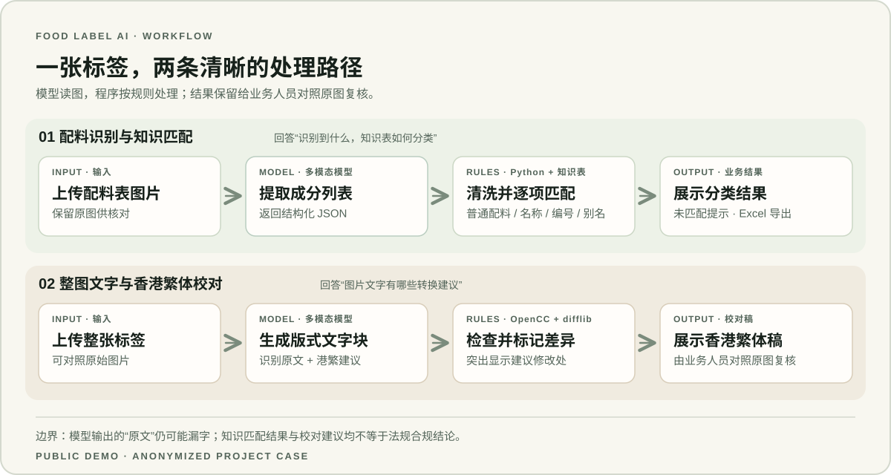

# 食品标签 AI 识别与香港繁体校对

**Food Label AI Assistant · 项目时间：2026 年 4 月 · 独立完成：Alexis Tsui**

将食品标签图片转为可检查的结构化信息，结合知识匹配与文字差异展示，辅助进口业务人员完成日常标签校验。

[阅读完整项目案例](https://alexistsui94.github.io/projects/hk-food-label-checker/) · [查看技术说明](ARCHITECTURE.md) · [查看验证计划](EVALUATION.md)



[打开完整项目图](../../projects/hk-food-label-checker/flow.svg)

## 项目概览

| 项目 | 内容 |
| --- | --- |
| 使用者 | 客户方负责进口业务的人员；公开版本匿名展示客户 |
| 我的职责 | 独立负责需求梳理、知识资料整理、提示词设计、模型接入、程序开发、界面实现和交付反馈跟进 |
| 功能 | 配料识别、添加剂知识匹配、香港繁体校对、差异标记、Excel 导出 |
| 技术 | Python、Streamlit、DashScope 多模态模型、pandas、OpenCC、结构化 Excel 知识表 |
| 使用情况 | 已有客户进口业务人员实际使用 |
| 用户反馈 | 据项目负责人转述，用户评价积极，认为减少了很多校验工作 |
| 效果证据 | 当前为定性反馈；未开展系统的准确率、节省比例或 ROI 统计 |

## 为什么做这个工具

工具围绕进口业务中的食品标签检查展开，将图片识别、添加剂资料查询和繁体校对整合到一个界面。目标是减少人工反复读取、查询和整理的工作，并让结果方便对照与复核。

这是辅助检查应用，不自动作出食品安全或法规合规结论。原始业务规模、用户数量和处理时长未在公开案例中作未经验证的量化描述。

## 两条业务流程

### 1. 配料识别与知识匹配

上传配料表图片 → 多模态模型提取成分 JSON → 程序解析、清洗和去重 → 查询结构化知识库 → 显示匹配结果、普通配料和未匹配项 → 导出 Excel。

知识匹配顺序为：普通配料识别、标准名称匹配、E 编号匹配、别名匹配、近似匹配。近似匹配展示字符串相似度；该分数不等于模型置信度或业务准确率。

### 2. 标签文字与香港繁体校对

上传标签图片 → 模型按阅读顺序生成标题、字段、段落等文本块 → 同时提供识别原文及香港繁体建议 → OpenCC 对识别原文作转换检查 → 使用文本差异算法突出显示模型建议中的修改。

“识别原文”仍是模型输出，可能漏字或误识别，需要与原图核对。校对稿是接近阅读结构的文字呈现，不是对原包装图片直接编辑。

## 架构取舍

- 用多模态模型处理非结构化图片，用代码和知识表处理可确定的映射关系。
- 通过 JSON 接口衔接模型和应用，避免依赖自由文本解析业务结果。
- 用表格组织标准名称、别名、编号和普通配料，便于理解和维护。
- 提供异常提示和导出结果，将人工复核保留在流程中。
- 当前属于固定流程 AI 应用；没有实现自主工具规划的 Agent，也没有将检索结果回填给模型生成答案的 RAG 链路。

## 公开代码的范围

此目录为从原项目整理的匿名化示例版本，不包含客户名称、客户标签图片、原始知识库、密钥、账号或历史 Git 对象。原项目记录显示 2026 年 4 月存在开发提交；此次公开整理的修改与测试不计入原项目历史能力。

整理时补充了缺失的 `python-dotenv` 依赖、离线测试及合成数据生成器，并修正了空登录配置、模型配置读取时机、成分名前导数字清洗和别名布尔值判断等问题。未在客户原始项目上写入这些更改。

## 本地运行

需要 Python 3.10 或更新版本。进入本目录后，在独立虚拟环境安装依赖：

```bash
python -m venv .venv
# Windows PowerShell: .venv\Scripts\Activate.ps1
# macOS / Linux: source .venv/bin/activate
python -m pip install -r requirements.txt
python make_demo_data.py
```

把 `.env.example` 复制为本地 `.env`，设置自己的模型 API Key、模型名以及非空登录账号和密码。不要提交 `.env`。

```bash
python -m streamlit run app.py
```

生成的 `demo_knowledge.xlsx` 只包含合成的“演示成分甲／乙”等记录，编号和功能均为虚构，不能用于真实食品判断。可用包含“水、白砂糖、演示成分甲、测试别名B”的自制图片理解流程。

运行识别功能会将所选图片发送至配置的 DashScope 模型服务，并可能产生 API 费用；仅使用你有权处理的测试图片。GitHub Pages 展示静态项目案例，不托管这个 Python 服务，也不接收标签上传。

## 离线验证

```bash
python -m unittest discover -s tests -v
```

这些测试不调用模型、不需要 API Key，检查解析、名称保留、知识匹配、普通配料与未知项区分、模型配置以及文字转换。通过这些检查不代表已经验证图片识别准确率或法规正确性。

## 与 ERP 实施经验的连接

这个项目把需求拆解、主数据标准化、业务规则、异常处理和用户交付经验用于 AI 应用。核心实践是：将真实任务拆成清晰的输入、处理和输出，再用模型、程序和人工复核分别承担适合的部分。

## 后续方向

建立有人工标准答案的标签测试集；统计漏识别、误匹配、建议误改、总耗时和人工修正量；增加识别结果确认环节；补充知识版本和来源记录；在扩大使用前完善审计、身份管理及调用用量管理。

## 资料依据

- 实现依据：本目录 `app.py`、`core.py`、`knowledge.py`、`script_checker.py`。
- 项目职责与使用反馈：作者确认；反馈为转述而非正式用户调查。
- 原始项目时间：作者说明及本地 Git 开发记录，2026 年 4 月。
- 本公开版本的补充说明：`ARCHITECTURE.md`、`EVALUATION.md`。

